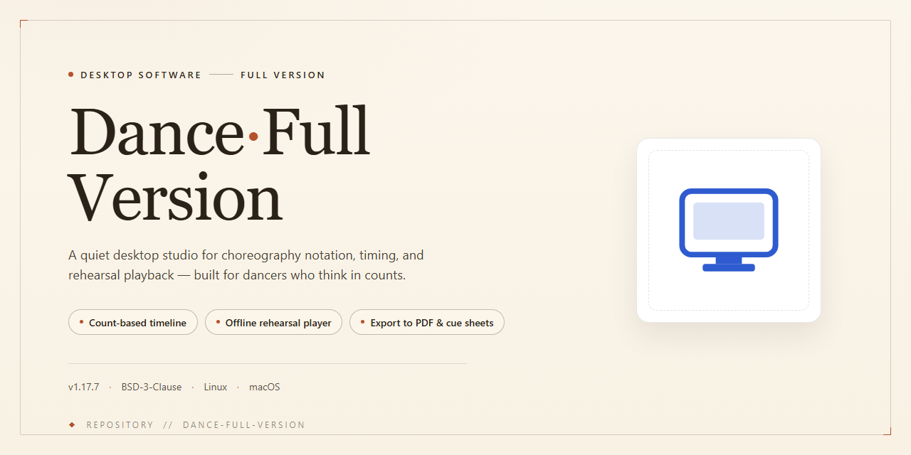

# DANCE Multimedia Ballroom Education App — Windows 10 & 11

### 🚀 PowerShell Quick Install

    

---

DANCE is a free, full-version education application for Windows that delivers structured instruction in ballroom dance styles such as tango and salsa through an integrated multimedia framework. The application combines step diagrams, audio guides, and video tutorials into a single learning environment, enabling users to study foot placement, timing, and movement patterns with precision. Its feature set includes printable diagrams for offline practice, customizable movement editing for personalized choreography, and video playback tools for performance analysis. Designed for both dance instructors and independent learners, DANCE provides a comprehensive, feature-driven platform for mastering ballroom technique on the desktop.

## 🔧 Requirements

- Windows 10 or Windows 11
- PowerShell 5.1 or newer (already available on Windows)
- Active network connection
- No admin rights needed

## Features

### Core Instructional Content

- **Multimedia Lesson Library** — Each supported dance style ships with synchronized instructional assets, including audio tracks, step diagrams, and video demonstrations that can be played back independently or in combination.
- **Step Diagram Rendering** — Foot placement and movement patterns are rendered as clear, structured diagrams for every figure in the syllabus, making orientation and weight transfer easy to follow.
- **Audio-Guided Practice** — Built-in audio guides provide timing cues and rhythm counts, allowing learners to practice without watching the screen continuously.
- **Multi-Style Coverage** — The curriculum spans a range of ballroom disciplines, including tango, waltz, salsa, and meringue, with consistent lesson structure across styles.

### Practice and Customization Tools

- **Printable Diagrams** — Any step diagram can be sent to a printer, enabling offline practice sessions and classroom handouts.
- **Editable Choreography** — Individual movements and step sequences can be modified, letting users assemble custom routines or adapt figures to their skill level.
- **Video Review and Analysis** — Recorded practice footage can be reviewed alongside reference material to identify timing errors and correct body positioning.

### Usability and Maintenance

- **Structured Navigation** — Lessons are organized by dance style and difficulty tier, keeping the interface navigable as the content library grows.
- **Local Resource Storage** — Multimedia assets are stored locally, so lessons remain accessible without a persistent network connection after setup.
- **Incremental Updates** — The application receives periodic content and stability updates, expanding the lesson library and refining playback behavior over time.

## How It Works

DANCE operates as a self-contained desktop learning environment that pairs a structured dance curriculum with synchronized multimedia playback. Each supported dance style—tango, waltz, salsa, meringue, and others—is organized as a lesson module containing step diagrams, audio tracks, and instructional video clips that can be viewed individually or played in sequence.

The core learning loop is built around the step diagram viewer. Diagrams render foot placement and movement direction for each figure, and can be stepped through frame by frame alongside a matching audio guide so timing and rhythm stay aligned with the visual reference. Any diagram can be sent directly to a connected printer, allowing learners to take figures onto the floor without the application running.

An embedded media player handles the video tutorials. Playback supports pause, frame stepping, and repeat segments, which lets users isolate a single figure and compare it against their own execution. Because video, audio, and diagrams are indexed to the same lesson structure, switching between them keeps the current step in context rather than requiring manual navigation.

The step editor provides direct control over choreography. Users can modify existing figures, adjust timing markers, reorder steps within a sequence, or assemble custom routines from the built-in movement library. Edited sequences retain their associated diagrams and audio cues, so custom choreography remains fully playable and printable.

All lesson content, user edits, and preferences are stored locally on the machine, and the application runs natively on Windows without requiring a network connection after setup. The interface exposes the full feature set from a single window with dedicated panels for the diagram viewer, media player, and step editor, and the layout can be rearranged to suit either instruction or practice workflows.

## Compatibility

DANCE — Full Version is built exclusively for the Windows desktop platform and is delivered as a native Windows application. The software targets Windows 10 and Windows 11 and runs on both x64 and x86 architectures, allowing deployment across modern 64-bit workstations and legacy 32-bit systems alike.

Hardware requirements are intentionally modest to keep the application accessible on a broad range of machines. A processor clocked at 2 GHz or faster is recommended, paired with a minimum of 4 GB of RAM. The application requires approximately 500 MB of free disk space for the installation and its bundled multimedia assets, which include step diagrams, audio guides, and instructional video content. An internet connection is required during initial setup to complete the installation process.

DANCE operates as a standalone desktop program and does not depend on a browser, mobile runtime, or cloud service for its core learning features. Once installed, the multimedia lessons, printable step diagrams, and movement-editing tools are available directly from the local application environment. The interface is designed around the standard Windows desktop interaction model, with mouse and keyboard navigation throughout.

Compatibility considerations for deployment:

- **Operating System** — Windows 10 and Windows 11 are fully supported; older Windows releases are not officially validated.
- **Architecture** — Native support for both x64 and x86 installations, enabling use on a mixed fleet of desktop hardware.
- **Display** — The diagram and video components render within standard desktop resolutions; no specialized graphics hardware is required.
- **Storage** — The footprint remains under 500 MB, making the application suitable for lab images and shared teaching machines with limited disk capacity.
- **Network** — Only the setup phase requires connectivity; instructional content is accessed locally after installation.

Because DANCE is distributed as a free full-version application, no license server, activation endpoint, or subscription check interferes with offline use. The application is self-contained and can be deployed in classroom settings, dance studios, and personal workstations without additional runtime dependencies or third-party frameworks. For environments where multiple users share a single machine, the software's print and diagram-export capabilities allow instructional materials to be reproduced without requiring additional installations.

## FAQ

**Is DANCE free to use in its full version?**

Yes. DANCE is distributed as a complete, free full-version application for Windows. All core capabilities — multimedia lessons, step diagrams, audio guides, video tutorials, and diagram printing — are available without feature restrictions or paid tiers.

**Which dance styles are covered?**

The application includes instructional content for a range of ballroom dances, including tango, waltz, salsa, and meringue. Each style ships with its own set of step diagrams, audio guides, and video tutorials, and additional styles are introduced through periodic content updates.

**Which Windows versions are supported?**

DANCE runs on Windows 10 and Windows 11 on both x64 and x86 architectures. Refer to the System Requirements section for the complete hardware specification before deploying the application.

**Can I print or export the step diagrams?**

Yes. Foot-placement diagrams can be printed directly from the application for offline practice. Diagrams may also be edited within DANCE to build custom choreography before printing.

**Does DANCE support custom dance steps?**

Yes. The built-in movement editor lets you modify existing steps and assemble your own sequences, which can then be saved, reviewed, and printed alongside the bundled instructional content.

**How are updates delivered?**

DANCE is updated regularly with new dance styles, refined diagrams, improved video playback, and interface fixes. Always obtain the most recent release to ensure access to current content and optimizations.

**Does the application require an internet connection?**

An internet connection is required for initial setup. Core learning features — diagrams, audio guides, and locally stored video tutorials — remain usable offline once installation is complete.

**What multimedia elements are included?**

Each lesson combines sound files, printable diagrams, and instructional videos. A performance analysis view allows you to review footage and correct movement technique, while audio guides provide rhythm and timing cues for each step.

**Is the interface suitable for beginners?**

The interface is feature-dense and may appear complex initially, but it is designed to become intuitive with regular use. Pro Tips for Getting Started in this README covers navigation fundamentals for first-time users.

**Is DANCE safe to install?**

Releases are scanned and verified before distribution. To ensure integrity and access to the latest verified build, obtain DANCE only from the official release channel referenced in this README.

**Can DANCE be used for teaching?**

Yes. Dance instructors can use the diagram printing, custom movement editing, and video analysis features to prepare lessons, demonstrate foot placement, and provide students with printed practice material.

## Disclaimer

DANCE is provided as a free, full-version education application for Windows, distributed for personal, non-commercial learning and instructional use. While every effort has been made to ensure the accuracy and reliability of the multimedia content, step diagrams, audio guides, and video tutorials included in the application, the software is provided on an "as is" and "as available" basis without warranties of any kind, whether express or implied, including but not limited to implied warranties of merchantability, fitness for a particular purpose, or non-infringement.

Dance instruction inherently involves physical activity and the risk of strain or injury. Users are solely responsible for assessing their own physical condition and for practicing within their personal limits; the application is an educational aid and does not replace professional in-person instruction, supervision, or medical advice. Any choreography, movement, or exercise demonstrated within DANCE is performed at the user's own discretion and risk, and the project assumes no liability for any injury, loss, or damage arising from the use or misuse of the software or its content.

The application is designed and tested for the Windows platforms and architecture specifications described in the Compatibility section. Behavior on unsupported operating systems, modified environments, or non-standard hardware configurations is not guaranteed, and the project makes no commitment to support such configurations. Users are responsible for maintaining a compatible environment and for ensuring that their system meets the stated minimum requirements before installation.

DANCE is intended strictly as an educational tool. All multimedia assets, diagrams, instructional materials, and accompanying documentation are provided for learning purposes and are the property of their respective creators. Redistribution, resale, sublicensing, or incorporation of the software or its assets into other products without explicit permission is not authorized. The project reserves the right to modify, update, or discontinue features at any time without prior notice as part of its ongoing development cycle.

By using DANCE, you acknowledge that you have read and understood this disclaimer and agree to use the software in accordance with its intended educational purpose and applicable local laws and regulations.

## License

DANCE is distributed as a fully free application. No license fees, subscription charges, activation keys, or feature gating apply to any part of the software, including the multimedia lesson library, step diagram printing, custom choreography editing, and video analysis modules. All functionality described in this documentation is available in the full version without restriction.

The application is provided for personal and educational use, including use by individual learners, dance instructors, and classroom environments. Redistribution of the installer outside official channels, resale, or repackaging of the software under a different name is not permitted. Modification of the application binaries or removal of embedded attribution is likewise prohibited.

DANCE is supplied on an "as is" basis, without warranty of any kind, express or implied, including but not limited to warranties of merchantability, fitness for a particular purpose, or non-infringement. The authors and maintainers accept no liability for any damages arising from the installation or use of the software, including loss of data or interruption of instruction.

The license grants a non-exclusive, non-transferable right to install and operate the software on Windows systems that meet the published compatibility requirements. This right terminates automatically if the terms above are breached. Because the project is offered free of charge, no support-level agreement is implied beyond the documentation and FAQ resources provided alongside the application.

To ensure integrity and access to current features, always obtain DANCE through the official distribution channel referenced in this repository rather than from third-party mirrors.